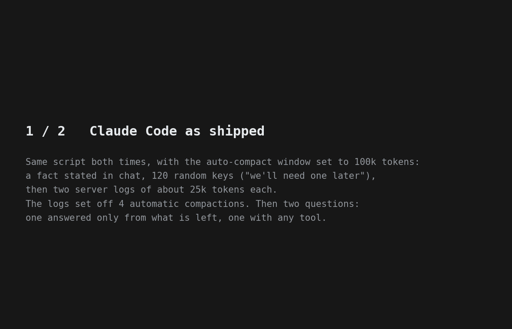
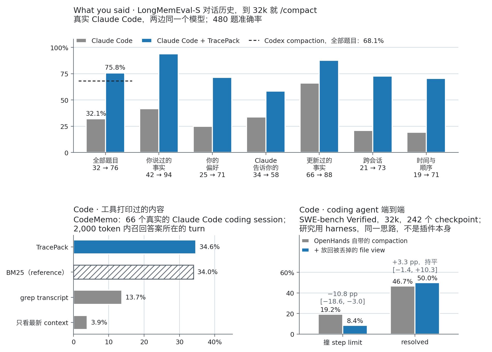

# TracePack

**中文** | [English](README.en.md)

**compaction 时不丢你说过的话。`/compact` 之后，原文一字不差地回来。**

Claude Code 对长会话做 compaction 时，summary 会留下计划、丢掉细节：确切的报错原文、它创建的路径、benchmark 打印出来的数字、你两小时前提到的端口。TracePack 在每次 compaction 之后把这些内容**原样**放回去，并标明每一条出自哪里；整个过程不调用模型，也不把任何东西发出你的机器。



<sub>在 Claude Code 2.1.302（Sonnet 5.5）里实录：同一个脚本跑在两个会话里，左边是原版，右边装了 TracePack，auto-compact 窗口都设为 100k token。等模型的时间剪掉了，两边都按 1.3 倍速播放，所以保持同步。这是 4 次运行中的第 3 次。4 次里，原版 Claude Code 只有一次凭手上已有的内容答出了 key087（那次的 summary 恰好保留了这些 key），另外三次都要搜 transcript 才找到 key042（分别用了 24 秒、22 秒和 5 秒）。装了 TracePack 的 4 次都是两题立刻答出，不调用任何工具：每次 compaction 之后，它都把完整的 key 列表放了回去。结尾的卡片引用的是真实的 summary 和真实 restore 的内容，每个答案都和打印出来的值一致。点击可以看大图。</sub>

<picture><source media="(prefers-color-scheme: dark)" srcset="assets/results-zh-dark.png"></picture>

`32% → 76%`：在 LongMemEval-S 上、到 32k 就 compaction 时，Claude Code 的准确率 · `2.5×`：在真实的 Claude Code coding session 里，召回的 evidence 是 grep 的 2.5 倍（和 BM25 打平，不用模型） · `−10.8 pp`：SWE-bench Verified 上撞 step limit 的比例（resolve rate 持平）

```
/plugin marketplace add oklen/TracePack
/plugin install tracepack@tracepack
```

Agent memory 系列：[VeraKV](https://github.com/oklen/VeraKV)：该把什么交给模型 · [Compute Globally, Materialize Locally](https://github.com/oklen/Compute-Globally-Materialize-Locally)：evict 之后什么还在 · [TracePack](https://github.com/oklen/TracePack)：compaction 之后什么还在

[](LICENSE)   

## 结果

### 装上 TracePack 的 Claude Code：LongMemEval 上 +43.7 个点

真实的 Claude Code（2.1.294）把同样 480 道 LongMemEval-S 题答了两遍，一遍原版，一遍装了这个插件。每道题：
- 把历史（约 50 个对话 session，~115k token）replay 进一个 Claude Code 会话；
- 对话每超过 32k token，就用 `/compact` 压缩一次（几乎每道题都 compact 三次）；
- 然后只凭剩下的内容作答，不用工具。

每个 arm 都用同一个模型（DeepSeek-V4-Pro，通过内置的 bridge）和同样的 compaction 时机，答案用 LongMemEval 官方的 prompt 评分。

| 480 题，同一个模型 | 准确率 |
|---|---|
| **Claude Code + TracePack** | **75.8%** |
| Claude Code + TracePack，只用 notes | 70.2% |
| Claude Code + TracePack，只放回你的原话 | 53.8% |
| Claude Code | 32.1% |
| *参考：Codex 的 compaction* | *68.1%* |

- **+43.7 个点，95% CI [+39.0, +48.5]。** 赢 219 题、输 9 题，六种题型全部更高：multi-session 21% → 73%，temporal reasoning 19% → 71%，用户说过的事实 42% → 94%。
- **两部分各自都有用。** 带日期的 notes 带来 +38.1，放回你的原话带来 +21.7。
- **为什么原版 Claude Code 在这里输这么多。** 它的 compaction prompt 是为写代码设计的：需求、文件、报错、下一步。compact 三次之后，大部分个人信息都没了，480 题里有 271 题它回答「I don't have that information」（装了 TracePack 是 80 题）。和 Codex 不同，它不会原样保留你的任何一条消息。
- **代价：** summary 长约 45%（中位数 5.5k vs 3.8k token），每次 compaction 后再加约 2.2k token 的 restore 内容。
- **还剩多少空间。** 研究里的方法在同一 harness、同一模型下得 81.9%。它原样保留的部分大三倍（6.5k token，由模型挑选），插件是在本地挑的 2k token。

这个设置是故意设难的：32k 的窗口逼着 115k token 的历史 compact 三次。Claude Code 实际的窗口是 200k，所以只有长得多的会话才会遇到这种情况。和日常使用相比还有两点不同：
- 模型是 DeepSeek-V4-Pro，不是 Claude；
- Claude Code 会把机器上的日期告诉模型，而每道题有自己的日期。

用 `tracepack bench lme run --arms claude-code,claude-code+tracepack` 复现（[方法](docs/BENCH_LME.md)）。

### 保住没法重读的东西：比 Codex 高 17.5 个点

context 满了的时候，Codex 的 compaction 会写一份任务进展的 hand-off summary，赌的是 agent 之后能重新读到任何细节。对文件来说这行得通；对用户说过的话就不行，因为这些话别处都没有：在需要的事实就在屏幕上的 305 个 case 里，Codex 的 hand-off summary 只保留了 4 个。

TracePack 的研究方案专门保留这些事实：一份 note-taking 式的 summary，配上用户自己的消息，消息按内容挑选、原样保留，从不改写。在 **LongMemEval-S**（长对话，历史约 115k token）上，用 32k 的窗口，每道题的历史大约被 compact 三次：

| 480 题，同样的 time window，同样的 reader | 准确率 |
|---|---|
| **TracePack 的 compaction**（note-taking summary + 用户原话，原样保留） | **86.0%** |
| Codex 的 compaction（按 Codex 源码重新实现） | 68.5% |

- **+17.5 个点，95% CI [+13.3, +21.7]。** 六种题型全部更高，在 **280 道新题上 +19.3**。
- **同样的 budget 全花在 note-taking summary 上，和它打平**（+1.0 [−2.3, +4.2]）。TracePack 拿到这个结果时少生成 30% 的 token。
- **在 SWE-bench Verified（32k）上**，每次 compaction 后把被丢掉的 file view 放回去，agent 撞 step limit 的情况比 OpenHands 自带的 compaction **少 10.8 个点**（−10.8 [−18.6, −3.0]）。resolve rate 持平。

这些是我们研究 harness 里 pre-registered 的 paired 运行。其中 LongMemEval 部分现在以 `tracepack bench lme` 的形式放在本仓库：prompt 和研究里的逐字节一致，喂入研究里的 verdict，它的 report 就会打出这张表。换成 DeepSeek-V4-Pro 当模型重跑，同样的方法比 Codex 的 compaction 高 +13.7 [+8.8, +18.5]。细节和其他 benchmark 见 [research notes](docs/RESEARCH.md)。

### compaction 之后的 recall：召回的正确内容是 grep 的 2.5 倍

**CodeMemo** 是一个公开 benchmark，在 66 个真实的 Claude Code 会话上出了 153 道题（每个项目最多 430 MB 的历史）。下面是在同样 2,000 token 的 budget 内，包含答案的那个 turn 被原样召回的比例：

| 2,000 token 以内 | 召回答案所在的 turn | 召回确切的值 |
|---|---|---|
| **TracePack** | **34.6%** | **47%** |
| grep transcript（没有它时 Claude 的做法） | 13.7% | 17% |
| 还留在 context 里的（最新的 2,000 token） | 3.9% | 12% |
| *参考：基于消息的 BM25 搜索引擎* | *34.0%* | *47%* |

- **evidence 是 grep transcript 的 2.5 倍，确切的值是 2.8 倍**，大约是 context 里剩下内容的 9 倍。
- **在 debug 历史上是 4.7 倍。** 对「我们当时是怎么定位和修好 X 的」这类题，它是 48%，grep 是 10%。
- **和 BM25 搜索引擎一样好，而且是为 agent 打包好的。** 每条都是完整的 record，标明 tool、时间和 transcript 里的行号；tool call 会带上它简短的输出；有硬性的 budget 上限。
- **不用模型，不联网。** 在最多 52,000 条 record 的历史上，每题约 0.4 秒。
- **在 Claude Code 里实际可用。** `/compact` 之前打印的一个随机 key，一轮之内原样回来，不需要重新运行任何东西。

这个测试不用模型、结果确定：CodeMemo 标为每道题 evidence 的那几个 turn，必须在 budget 内被召回。运行 `tracepack bench codememo --data <CodeMemo 目录>` 即可复现。TracePack 的默认设置是在奇数编号的题上选的；在 held-out 的偶数编号那一半上，evidence 和 BM25 打平（34.7% vs 34.7%），确切的值领先（43% vs 40%）。完整的表见 [Benchmark](#benchmark)。

## 安装

在 Claude Code 里：

```
/plugin marketplace add oklen/TracePack
/plugin install tracepack@tracepack
```

Claude Code 2.1.275 及以上，一条命令就能完成这两步（2.1.292 及以上，也可以在 shell 里用 `claude plugin install` 加同样的参数）：

```
/plugin install tracepack --marketplace oklen/TracePack
```

然后重启 Claude Code，或者运行 `/reload-plugins`。用 `/tracepack:status` 检查是否正常。

需要 `PATH` 里有 Python 3.9+，命令名 `python3`。macOS 和大多数 Linux 发行版都自带。不会装其他任何东西。

## 60 秒上手

1. 让 Claude 运行下面这行，然后回复「done」：
   ```
   python3 -c "import secrets; [print('key%02d' % i, secrets.token_hex(8)) for i in range(30)]"
   ```
2. 运行 `/compact`。
3. 问：*「key17 是多少？什么都别运行。」*

随机生成的 key 没法再生成一遍，所以只有原始输出里有答案。compaction 一结束你就会看到 *TracePack restored N exact records*，`/tracepack:last` 会显示具体放回了什么。然后 Claude 在一轮之内根据 restore 的输出作答，不重新运行任何东西。

在这么短的会话里，Claude Code 自己的 summary 也可能保留这些 key。差别出现在长会话里，那时 summary 不得不丢掉大部分输出。没有 TracePack 时，Claude 只能重新运行命令（得到另一组 key），或者 grep 它自己的 transcript 文件。

## 你能得到什么

- **Claude Code 的 compaction 会写 notes。** 每次 compaction（手动或自动）都会额外写一个带日期的「Notes」小节：你说过的每个事实（需求、约束、偏好、名字、数字、路径、版本）、Claude 给你的每个回答、每处改动（连同旧值和新值），各占一行。值按原话照抄，notes 会从一次 compaction 延续到下一次。
- **每次 compaction 之后，你自己的话会回来。** 在约 2,000 token 以内，TracePack 会放回：
  - 你说过的陈述事实的句子，从你说过的全部话里按内容挑选，原样保留并带日期；
  - 最新的 tool output；
  - 你的 `/compact` 指令和最近的请求所指向的 record。

  它们按发生的先后排列，每条都有标签，例如 `Bash output of \`pytest -q\` · 10-08 13:14 · L22`。
- **一个 `recall` 工具**，用来找 compaction 之前的其他任何内容。Claude 用大白话提问（*「上一次 pytest 的确切报错」*、*「用户给的数据库端口」*），拿到 budget 以内的原样 record，每条标明是哪次 tool call 产生的。
- **一个 `expand` 工具**，分页查看某一条长 record 的全文。
- **命令：**
  - `/tracepack:recall <问题>`
  - `/tracepack:status`
  - `/tracepack:last`，显示上一次 compaction 之后具体加了什么。

下面是 compaction 之后 Claude 看到的内容（内置的 demo 会话；运行 `tracepack demo`）：

```
TracePack: the user's own words from before the compaction, verbatim. These sentences were picked
because they state facts (names, numbers, dates, preferences, decisions, constraints); "…" marks
where a message was shortened. The summary above may have paraphrased them.

[u1] user said · 2026-10-08 17:00 · L1
… Profile it and keep the numbers; the staging DB is at port 6543.

[u2] user said · 2026-10-08 17:10 · L11
… Also the migration id we must not touch is 2026_09_30_add_ledger_index.

TracePack: 7 verbatim records from this session before the compaction, in the order they happened.
The summary above may have shortened them. Other records can be looked up with the TracePack recall tool.

[2] Bash output of `python bench.py --rows 200000` · 10-08 17:02 · L3
rows=200000 elapsed=41.7s p95_latency=812ms
hot path: parse_rows 63% of time
...
[5] Edit call · 10-08 17:06 · L7
Edit {"file_path": "/work/demo/bench/parse.py", "new_string": "for line in buf.splitlines():", ...}
...
[7] Bash output of `python bench.py --rows 200000` · 10-08 17:09 · L10
rows=200000 elapsed=29.3s p95_latency=530ms
hot path: parse_rows 41% of time
```

## 工作原理

- **它只读，不记录。** Claude Code 本来就会把每条消息和每个 tool output 写进 `~/.claude/projects/<project>/<session>.jsonl`。TracePack 只读这个文件。
- **它知道 Claude 已经看不到什么。**
  - 按 id 把每次 tool call 和它的 output 配对。
  - 能识别 compaction，包括 compaction 时原样保留下来的那些消息。
  - 只在已经掉出 context 的内容里搜索，所以不会把 budget 花在重复 Claude 已经有的东西上。
- **排序不用模型。** 用 BM25 给 record 和问题打分。
- **用完整的 record 填满 budget，最好的排在前面。**
  - tool output 会标明是哪次 tool call 产生的。
  - tool call 会带上它简短的 output。
  - 如果排在前面的 record 太大、剩下的 budget 放不下，就换成它匹配行的带标签摘录；不会悄悄截掉任何东西。
  - 最后按发生的先后顺序展示这些 record。
- **它会 mask 掉密钥。** 交回的所有内容里，看起来像凭据的字符串（API key、token、密码）都会被遮掉。
- **挑你的话也不用模型。** 你写的每个句子都按事实密度打分：数字、日期、名字、标识符、第一人称陈述、偏好、计划、决定，以及「never」「must」这类约束。提问、道谢和粘贴进来的材料得分低。每 token 事实最多的句子会回来，所以一条长消息里的那一个事实可以单独回来，不必带上其余部分。
- **两个 hook，开销都很小：**
  - PreCompact 记下你的 `/compact` 指令，并打印 note-taking 的说明。Claude Code 会把 PreCompact hook 打印的内容接在你的 `/compact` 指令后面，一起放进它自己的 compaction prompt。
  - SessionStart 在 compaction 刚结束时，把你的话和 record 加回去。

  没有逐次 tool call 的 hook，没有 daemon，也不占端口。Claude Code 是在这些 hook 运行之后才写 compaction summary 的，所以 TracePack 根据你的 `/compact` 指令和最新的工作来构造 query，并把最新的 tool output 放在最前面。

## 什么时候有用，什么时候没用

它适合那些没法便宜地重新拿到的细节：
- 只打印过一次的值：随机 id、耗时、benchmark 的数字；
- 慢的、远程的或有副作用的命令的输出；
- 你在聊天里告诉 Claude 的事情；
- 后来已经改过的文件的旧版本。

如果一个细节可以便宜地重读（文件还在），让 Claude 重读效果一样好。没有 TracePack 时，如果 summary 给了线索，Claude 有时也能用 grep 从原始 transcript 文件里挖出某个值，代价是在 JSON lines 上多一次 tool call。

我们的研究测量发现，compaction 中丢失的细节大多可以便宜地重读。在 SWE-bench 上，加上这份 packet 并没有改变 resolve rate。TracePack 是为没法重读的那些情况准备的；见 [research notes](docs/RESEARCH.md)。

## 隐私与开销

- **只在本地运行。** 它读取你机器上的文件，并在插件的 data 目录（`~/.claude/plugins/data/tracepack…`）里写几个小 JSON 文件。不发网络请求，不收集 telemetry，也不调用模型。
- **研究代码只在你运行它时才联网。** 这个仓库还包含 benchmark 和研究代码（`tracepack bench` 以及 `eval`、`pilot`、`profiler`、`baselines` 几个目录）。`tracepack bench lme download` 会从 Hugging Face 下载 LongMemEval，需要模型的 benchmark 会调用你配置的 endpoint。插件的 hook 和 MCP server 从不运行这些代码。
- **开销。** 唯一的开销是它加进来的 token：每次 compaction summary 里的 notes，以及每次 compaction 之后最多约 2,000 token。除此之外没有。`recall` 返回的 tool output 有多大，由 Claude 请求的 budget 决定。
- **你的文件保持原样。** 它从不写入你的仓库或你的设置。
- **transcript 会过期。** transcript 归 Claude Code 管，过了 `cleanupPeriodDays`（默认 30 天）就会被删除。TracePack 只能 recall 还存在的内容。

## 设置

默认设置不需要任何配置。要修改的话，就设环境变量，例如写在 `~/.claude/settings.json` 的 `"env"` 下：

| 变量 | 默认值 | 作用 |
|---|---|---|
| `TRACEPACK_NOTES` | `1` | 让每次 compaction 都保留带日期的 notes。`0` 关闭。 |
| `TRACEPACK_INJECT_BUDGET` | `2000` | 每次 compaction 后加回的 token 数（最多 8,000 个字符）。`0` 关闭。 |
| `TRACEPACK_USER_WORDS` | `1` | 加回的内容里包含你自己的句子。`0` 只加 record。 |
| `TRACEPACK_RECALL_BUDGET` | `2000` | `recall` 回答的默认大小。 |
| `TRACEPACK_MAX_MB` | `64` | transcript 非常大时，只读最新的那部分。 |
| `TRACEPACK_REDACT` | `1` | mask 掉看起来像凭据的字符串。`0` 关闭。 |

## 命令行

同一个引擎在 Claude Code 之外也能用：

```bash
uv tool install git+https://github.com/oklen/TracePack     # 或者：pipx install git+https://github.com/oklen/TracePack
tracepack recall "exact error from the last pytest run"     # 当前项目最新的会话
tracepack recall "the port I gave you" --session <id 或路径>
tracepack expand 417                                        # 一条 record 的全文
tracepack status | last | sessions | demo | doctor
tracepack bench codememo --data <CodeMemo 目录>            # recall benchmark（不用模型）
tracepack bench lme run --arms tracepack,codex --out runs   # 带 compaction 的 LongMemEval（需要模型）
```

## 其他 agent（MCP）

`tracepack mcp` 是一个标准的 stdio MCP server，没有依赖，提供 `recall`、`expand` 和 `status`。任何 MCP client 都可以用：

```json
{ "mcpServers": { "tracepack": { "command": "tracepack", "args": ["mcp"] } } }
```

Python API 也能读 pi 会话和 OpenHands trace（`tracepack.pack`），还附带一个 OpenHands condenser 和一个 LlamaIndex memory block；见 [library reference](docs/RESEARCH.md)。

## Benchmark

[CodeMemo](https://github.com/laynepenney/codememo-benchmark)（MIT）在三个软件项目的 66 个 Claude Code 会话上出了 158 道题，其中 153 道的 evidence turn 可以定位。每个项目的会话按顺序拼成一段长历史，就像一个被 compact 了很多次的会话。对每道题和每个 budget，每种方法交回一些 record，我们检查两件事：
- **召回答案所在的 turn：** CodeMemo 列为答案 evidence 的那几个 turn 里，至少有一个在交回的 record 中。
- **召回确切的值**（括号里的数）：简短答案里的具体值原样出现。只统计简短答案里含数字、版本号、路径或标识符的题。

所有方法用同样的方式计 token（约 4 个字符一个 token）。

| 方法 | 1,000 token | 2,000 token | 4,000 token |
|---|---|---|---|
| **TracePack** | 26.1% (37%) | 34.6% (47%) | 39.2% (56%) |
| 基于消息的 BM25 | 29.4% (36%) | 34.0% (47%) | 40.5% (55%) |
| grep transcript | 10.5% (12%) | 13.7% (17%) | 17.0% (21%) |
| 只看最新 context | 3.3% (8%) | 3.9% (12%) | 5.2% (16%) |

- **TracePack** 是默认设置下的 `recall`：BM25 排序，按排名放入完整 record，带标签，把 tool call 的简短输出折进来，放不下的高排名 record 用摘录代替。
- **BM25** 是同样的排序，但没有标签和折叠：最强的简单 baseline。
- **grep** 读取包含问题里两个最具体的词的原始 JSON lines，按文件顺序，每行截到 2,000 个字符。
- **只看最新 context** 是能放下的最后那些 record。

按题目类别，2,000 token（召回答案所在的 turn）：

| 类别 | TracePack | BM25 | grep | 只看最新 context |
|---|---|---|---|---|
| Factual | 37% | 37% | 17% | 6% |
| Debug | 48% | 45% | 10% | 0% |
| Architecture | 32% | 32% | 7% | 4% |
| Temporal | 24% | 24% | 14% | 5% |
| Convention | 35% | 35% | 20% | 5% |
| Cross-session | 25% | 25% | 15% | 5% |

默认设置（用 BM25 而不是 BM25 加 hashing embedding、不做 dependency closure、按排名打包）是在奇数编号的题上选的，并在偶数编号的题上检查，都是 2,000 token：

| 哪一半 | 方法 | 答案所在的 turn | 确切的值 |
|---|---|---|---|
| 奇数（n=78） | tracepack | 34.6% | 51% |
| 奇数（n=78） | bm25 | 33.3% | 53% |
| 偶数（n=75） | tracepack | 34.7% | 43% |
| 偶数（n=75） | bm25 | 34.7% | 40% |

有两件事这里没有测：
- **答题准确率。** 那还取决于读这些 record 的模型。
- **`/compact` 之后的自动 restore。** 它用的是同一个 packer，只是把最新的 tool output 放在最前面。上面的 LongMemEval 结果端到端地测了 restore 和 notes。

早先的研究测量，包括 dependency closure 在哪里有用、在哪里没用，见 [research notes](docs/RESEARCH.md)。

### 带 compaction 的 LongMemEval

`tracepack bench lme` 就是上面那些 compaction 结果背后的 harness。每条 LongMemEval-S 历史（约 50 个 session，~115k token）流式送进 32k 的 context，每次装满就用该 arm 的方法 compact，最后只问一次问题，不用工具；答案用 LongMemEval 官方的 prompt 评分。各 arm：

- `tracepack`：研究里的方法（note-taking summary，加上按内容挑选、原样保留的用户消息）。
- `codex`：Codex CLI 的 compaction，按它的源码重新实现。
- `notes`：只用 note-taking summary，总 budget 相同。
- `full`：不 compaction。
- `claude-code` 和 `claude-code+tracepack`：真实的 Claude Code，分别不装和装这个插件，另有两个 ablation。

prompt、budget 和统计方法都和研究里的一样，测试会逐字节检查 prompt。任何 OpenAI 兼容的模型都可以用：

```bash
pip install tiktoken
export TRACEPACK_LLM_BASE_URL=… TRACEPACK_LLM_API_KEY=… TRACEPACK_LLM_MODEL=… TRACEPACK_JUDGE_MODEL=…
tracepack bench lme run --arms tracepack,codex --out runs/lme      # 可断点续跑；--dry-run 不发出任何调用
tracepack bench lme report --out runs/lme
```

每道题、每个 arm 大约消耗 150k 输入 token。环境设置、Claude Code 那两个 arm 和输出格式见 [docs/BENCH_LME.md](docs/BENCH_LME.md)。

## Troubleshooting

- **运行 `/tracepack:status` 或 `tracepack doctor`。** doctor 会检查 Python、找到你的 transcript，并用一个内置的示例会话把整条路径跑一遍。
- **`python3: command not found`：** 安装 Python 3.9+。
- **`/compact` 之后什么都没 restore：** 要么 compaction 之前没有符合条件的内容（没有 tool output，你也没说过含事实的句子），要么 `TRACEPACK_INJECT_BUDGET` 是 `0`。
- **手动 `/compact` 之后出现了 note-taking 的说明文字：** Claude Code 会把每个 PreCompact hook 的输出打印在 `/compact` 的结果里。`TRACEPACK_NOTES=0` 可以关掉 notes。
- **hook 报错：** 它们从不打断 Claude。错误会记到 data 目录下的 `hook_errors.log`，`tracepack doctor` 也会报出来。

## 卸载

```
/plugin uninstall tracepack@tracepack
/plugin marketplace remove tracepack
```

卸载会删除插件的 data 目录。你的 transcript 不受影响。

## 开发

```bash
python3 tracepack/tests/run_all.py                 # 310 个测试，按 contract 逐项检查
claude plugin validate . --strict                  # manifest、marketplace、hook、MCP 配置
claude --plugin-dir .                              # 在 Claude Code 里试用工作副本
```

版本记录见 [CHANGELOG](CHANGELOG.md)。

## 许可

MIT © 2026 Zefeng Cai，见 [LICENSE](LICENSE)。
